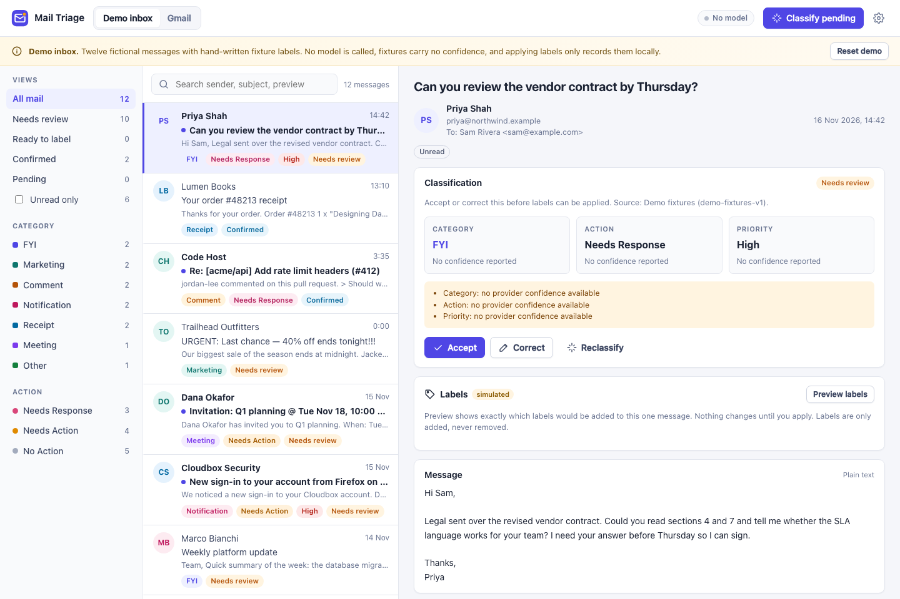
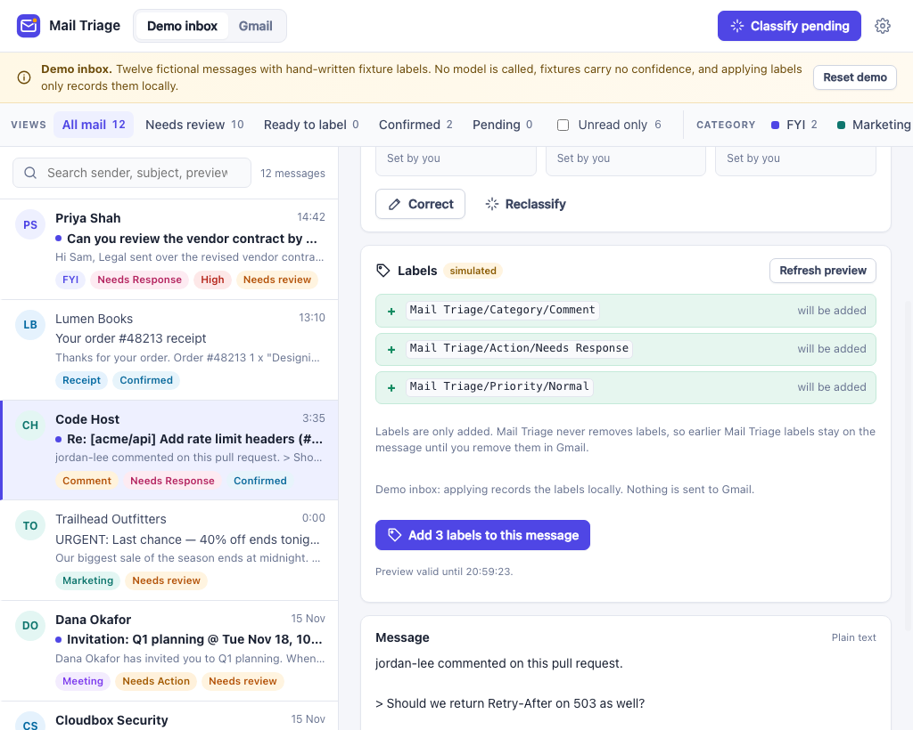

# Mail Triage

An open-source, Gmail-first email classifier for your Mac or a self-hosted server. Custom categories, separate action decisions, and explicit review before mailbox labels change.



- **Three separate decisions per message**: a **category** you define in plain English (defaults: FYI, Marketing, Comment, Notification, Receipt, Meeting, Other), an **action** (Needs Response, Needs Action, No Action), and a **priority** (Low, Normal, High).
- **Decision-model adapters** that call each provider's native endpoint: [Jev System One](https://docs.typesafe.ai/api/system-one.md) and [OpenAI Decisions](https://developers.openai.com/api/docs/guides/decisions). For local models, an [OpenAI-compatible adapter](https://ai-sdk.dev/providers/openai-compatible-providers) (Vercel AI SDK) works with Ollama or LM Studio.
- **Honest confidence**: provider confidence and the selected option's probability are stored and shown separately. Language models report neither, and Mail Triage never invents one.
- **Human review**: refused, invalid, unscored, and low-confidence answers wait for you. Your corrections are stored next to the model's answers.
- **No surprise mailbox changes**: you preview the labels for one message, then apply them. Labels are only added, never removed. Mail Triage never sends, deletes, archives, or marks mail as read.
- **One process, one SQLite file**: Express serves the API and the React UI. It runs on a Mac or in Docker.

This is a single-user tool. Similar projects already exist; see [docs/research.md](docs/research.md) for [Jev Mail Classifier](https://github.com/parth-kp/jev-mail-classifier) and [Inbox Zero](https://github.com/elie222/inbox-zero).

## Quick start (Mac, demo inbox)

Requires Node.js 22.12 or newer.

```sh
git clone https://github.com/k3shav/mail-triage.git
cd mail-triage
npm ci
npm run build
npm start
```

Open http://localhost:8787. The **demo inbox** has twelve fictional messages. The labels for these messages were written by hand as fixtures. Demo mode calls no model and shows no confidence, so every demo message waits for review. Accept or correct a message, then preview and apply labels. In the demo, applied labels are stored locally and never reach Gmail.

On a loopback address without `APP_PASSWORD`, the browser on this machine gets a session automatically. All API calls still require that session, and state changes require a same-origin request with a CSRF token.

## Configure a model

Set these values in a `.env` file (copy `.env.example`) or in the environment, then restart. Keys stay on the server.

| Provider | Settings | Confidence |
| --- | --- | --- |
| Jev System One | `MODEL_PROVIDER=jev`, `JEV_API_KEY=…` (model `jev-latest` by default) | Reported per answer, plus a probability for each option |
| OpenAI Decisions | `MODEL_PROVIDER=openai`, `OPENAI_API_KEY=…` (model `gpt-6-luna` by default) | Reported per answer, plus a probability for each option; per-question refusals |
| Ollama | `MODEL_PROVIDER=openai-compatible`, `OPENAI_COMPATIBLE_BASE_URL=http://localhost:11434/v1`, `MODEL_NAME=llama3.2` | None |
| LM Studio | `MODEL_PROVIDER=openai-compatible`, `OPENAI_COMPATIBLE_BASE_URL=http://localhost:1234/v1`, `MODEL_NAME=<loaded model>` | None |

`npm start`, `npm run dev`, and `npm run cli` load `.env` when it exists; Docker Compose loads it too. Real environment variables take precedence.

Notes:

- With Jev or OpenAI, email text (sender, recipients, subject, up to 8,000 characters of body) is sent to that provider. To keep mail on your machine, use a local model server.
- Each message is sent as data with an explicit untrusted-content notice. The model only picks from your options; it has no tools.
- The default review threshold (70%) is a starting point, not a calibrated value. Tune it in **Settings → Review policy** after checking how the confidence scores line up with your own labeled mail.
- Requests time out after 20 s (60 s for local models). Rate limits (429), server errors (5xx), and network errors get at most two retries with backoff.
- Try a model on one email from the command line: `npm run classify -- path/to/email.json`.

## Gmail OAuth setup

Mail Triage uses Google's [OAuth 2.0 for web server applications](https://developers.google.com/identity/protocols/oauth2/web-server). You create an OAuth client in your own Google Cloud project. Its type must be **Web application**: the client secret stays on this server, and Google redirects back to one exact registered URI. This is different from a **Desktop** (installed app) client, which uses a loopback redirect with PKCE and no client secret. Desktop clients do not work with Mail Triage.

1. In the [Google Cloud console](https://console.cloud.google.com/), create a project and enable the **Gmail API**.
2. Configure the **OAuth consent screen**. Choose user type External, or Internal if you use Workspace. Leave the app in **Testing** and add your address as a test user.
3. Create credentials: **OAuth client ID → Web application**. Under **Authorized redirect URIs**, add exactly:
   `http://localhost:8787/api/gmail/oauth/callback`
   (or `<PUBLIC_URL>/api/gmail/oauth/callback` for a server).
4. Add to `.env`:

   ```sh
   GOOGLE_CLIENT_ID=….apps.googleusercontent.com
   GOOGLE_CLIENT_SECRET=…
   # Paste the output of: openssl rand -base64 32
   MAIL_TRIAGE_ENCRYPTION_KEY=…
   # false = read-only; true = also allow applying labels (see Scopes below)
   GMAIL_LABEL_WRITES=false
   ```

5. Restart and open the app at the same host as the redirect URI (`http://localhost:8787`, not `127.0.0.1`), so the session cookie survives the Google redirect. Choose **Gmail → Connect Gmail**.

**Scopes.** With `GMAIL_LABEL_WRITES=false`, only `gmail.readonly` is requested. You can sync, classify, and preview labels, but you cannot apply them. With `true`, Mail Triage also requests `gmail.labels` (to create its labels) and `gmail.modify` (to add labels to a message). Gmail has no narrower scope for adding a label to a message. `gmail.modify` is broad: Google allows almost any mailbox read/write with it, except permanent deletion. Mail Triage's Gmail client has exactly two write methods: create a label, and add label IDs to a message. Google's consent screen can let you grant only some scopes. Mail Triage records the scopes you actually granted and turns off applying labels without `gmail.modify`.

**Tokens.** The refresh token is encrypted with AES-256-GCM using `MAIL_TRIAGE_ENCRYPTION_KEY`, and the ciphertext is bound to the account record. If Google omits a refresh token when you reconnect, Mail Triage keeps the stored one. Access tokens live only in memory, and no token is ever sent to the browser or written to logs. If you change the key, reconnect Gmail. **Disconnect** revokes the grant with Google, then deletes the account and all of its local mail data.

**Testing mode.** Google may expire refresh tokens for External apps in Testing status after about 7 days; reconnect when the app asks. Publishing an app that uses Gmail scopes for other people requires Google's verification. Mail Triage is meant for you to run with your own OAuth client.

## Using it

1. **Sync** fetches the newest inbox messages (default 50, at most 200). Mail Triage reads the full MIME structure, keeps plain text (or converts HTML to text), and skips attachments. It stores up to 64 KB of text per message. Reading never marks messages as read. Messages already stored are deduplicated, and only their labels and read state are refreshed. Gmail responses are read with streaming limits (4 MiB per full message, 2 MiB for other calls). A message over the limit is skipped and counted as failed, and the rest of the sync continues.
2. **Classify pending** classifies messages that have no decision under the current configuration. Each run handles at most `CLASSIFY_BATCH_SIZE` messages (default 20). A run stops early on authentication errors, missing configuration, or rate limits. A model answer is stored only if the message's decision and the configuration haven't changed since the request started. If you correct a message while the model is still working, your correction stays and the late answer is counted as *superseded*.
3. **Review**: messages show **Needs review**, **Ready** (the model was confident under your policy), or **Confirmed** (you accepted or corrected them). **Accept** keeps the model's answer, and **Correct** changes any field.
4. **Preview labels**, then **Add labels to this message**.



Labels look like `Mail Triage/Category/Receipt`, `Mail Triage/Action/Needs Action`, and `Mail Triage/Priority/High` (set the prefix with `LABEL_PREFIX`).

**Why previews can be rejected.** A preview is valid for 10 minutes. It is tied to the account, the Gmail message ID and thread, the configuration revision, the message's decision revision, and the provider and model. If any of these change before you apply, Mail Triage rejects the preview and you need a new one. Re-sending the same preview returns the earlier result without calling Gmail again. If two applies race, only one reaches Gmail.

**Labels accumulate.** Labels are only ever added. If you reclassify a message or edit categories after applying labels, the older Mail Triage labels stay on the message. The preview lists those labels and flags ones that conflict, but you have to remove outdated labels in Gmail yourself.

**Editing categories** (Settings → Categories) creates a new configuration revision. Decisions made under an earlier revision show as **Stale** and cannot be applied until you reclassify or confirm them. Category IDs never change when you rename a category.

### Scheduled sync and classification

The server does not poll on its own. To run sync and classification on a schedule, use the CLI. It shares the database with the server. Each run holds a per-mailbox SQLite lease (2 minutes, renewed every 20 seconds while the run is alive), so CLI and UI runs never overlap. If another process takes over the lease, the run stops, discards its pending results, and fails with `lease_lost`. The CLI never applies labels.

```sh
npm run cli -- status
npm run cli -- sync
npm run cli -- classify   # or: classify --demo, classify --limit 10
```

Example crontab entry (every 15 minutes):

```cron
*/15 * * * * cd /path/to/mail-triage && npm run --silent cli -- sync && npm run --silent cli -- classify
```

Cron runs with a minimal `PATH`, so use the full path to `npm` if needed. On a Mac you can run the same two commands from a `launchd` agent.

## Docker and self-hosted servers

```sh
cp .env.example .env    # set APP_PASSWORD, model, and Gmail settings
docker compose up -d --build
```

- Inside the container the server listens on `0.0.0.0`, so it **refuses to start without `APP_PASSWORD`** (12+ characters). Compose publishes the port on the host's `127.0.0.1` only.
- `APP_PASSWORD` is also required whenever the app can be reached from anywhere but this machine: a non-loopback `PUBLIC_URL` (for example, a reverse proxy forwarding `https://mail.example.com` to `127.0.0.1`), or `TRUST_PROXY=true`. Password-free local sessions are only for loopback-only setups.
- Data (SQLite with WAL) lives in the `mail-triage-data` volume at `/data`. Back up that volume, and back up the encryption key separately.
- For access from other machines, put an HTTPS reverse proxy in front and set:

  ```sh
  PUBLIC_URL=https://mail.example.com   # must be https off loopback
  TRUST_PROXY=true
  # Google redirect URI: https://mail.example.com/api/gmail/oauth/callback
  ```

  The proxy must pass the original `Host` header; the app rejects unknown hosts to block DNS rebinding. With an https `PUBLIC_URL`, the session cookie becomes `__Host-` prefixed and `Secure`. Example [Caddy](https://caddyserver.com/) site:

  ```caddyfile
  mail.example.com {
    reverse_proxy 127.0.0.1:8787
  }
  ```

The same rules apply without Docker.

## HTTP API notes

Every message's `decision` includes `taxonomyRevision`, `decisionSeq`, `source` (`model`, `human`, or `null`), and `sourceId`. A correction sends the first two back, so it only applies to the decision the reviewer actually saw:

```jsonc
// POST /api/mailboxes/:mailbox/messages/:id/corrections
// Accept the current model classification; its values are stored.
{ "kind": "accept", "expectedTaxonomyRevision": 3, "expectedDecisionSeq": 5, "basedOnClassificationId": 42 }
// Edit: set the values explicitly. basedOnClassificationId is optional.
{ "kind": "edit", "expectedTaxonomyRevision": 3, "expectedDecisionSeq": 5,
  "category": "receipt", "action": "no_action", "priority": "low", "basedOnClassificationId": 42 }
```

For an accept, `basedOnClassificationId` is `decision.sourceId` while `decision.source` is `"model"`. Errors:

| Status and code | Meaning |
| --- | --- |
| `409 stale_revision` | The configuration changed. |
| `409 stale_decision` | Another classification or correction landed first. |
| `409 classification_mismatch` | The ID is not a current-revision classification of this message. |
| `409 not_acceptable` | Not the current model decision, or it has refused or invalid answers. |
| `409 accept_mismatch` | The values sent with an accept differ from the classification. |
| `400 unknown_category` | The category does not exist. |
| `400 invalid_request` | Fields are missing or unknown. |

`POST …/messages/:id/classify` returns the message detail plus `outcome: "classified" | "superseded"`. `POST …/classify` returns `{ attempted, classified, needsReview, failed, superseded, remaining, stoppedEarly }`.

Label previews: `POST …/messages/:id/label-preview`, then `POST …/apply` with `{ "previewId": "pv_…" }`.

## Development

```sh
npm run dev        # API on :8787 (tsx watch) + Vite on http://localhost:5173 with /api proxied
npm run typecheck  # server, tests, and web
npm test           # Vitest; no network access, Google and model providers are faked
npm run build      # dist/node (server, CLI) and dist/web (UI)
```

In development, `WEB_DEV_URL=http://localhost:5173` is set for you. It lets the Vite origin make API calls and sends OAuth redirects back to Vite. It is accepted only on a loopback server. The `dev` script uses POSIX shell syntax for the environment variable.

Layout:

```
src/core        taxonomy, prompts, review policy (no I/O)
src/providers   Jev, OpenAI Decisions, OpenAI-compatible, demo fixtures
src/server      config, SQLite store, Gmail OAuth/client/MIME, services, HTTP
src/cli         CLI and single-email classifier
src/web         React UI
test            unit, contract, and HTTP tests
```

## Configuration reference

See [.env.example](.env.example) for every variable. Key settings:

| Variable | Default | Purpose |
| --- | --- | --- |
| `HOST` / `PORT` | `127.0.0.1` / `8787` | Bind address; non-loopback requires `APP_PASSWORD` |
| `PUBLIC_URL` | `http://localhost:<PORT>` | Origin used for CSRF checks, cookies, and the OAuth redirect |
| `APP_PASSWORD` | unset | Password sign-in; required off loopback |
| `MODEL_PROVIDER` | unset | `jev`, `openai`, or `openai-compatible` |
| `GOOGLE_CLIENT_ID` / `GOOGLE_CLIENT_SECRET` | unset | Web application OAuth client |
| `MAIL_TRIAGE_ENCRYPTION_KEY` | unset | 32-byte key for refresh-token encryption |
| `GMAIL_LABEL_WRITES` | `false` | Request `gmail.modify` and allow applying labels |
| `SYNC_MAX_MESSAGES` | `50` | Newest inbox messages per sync (1–200) |
| `CLASSIFY_BATCH_SIZE` | `20` | Messages per classification run (1–100) |
| `DEMO_INBOX` | `true` | Show the fictional demo inbox |

## Limitations

- The provider adapters follow the published request and response formats and are tested against recorded examples, with no network access. They have not been run against live Jev or OpenAI accounts in this repository. Availability, permissions, cost, latency, and accuracy depend on your account and your mail.
- The Gmail integration is tested against a simulated Google API. Before you rely on it, run it against your own account with `GMAIL_LABEL_WRITES=false`.
- Single user and one Gmail account at a time. Only the newest inbox messages are synced; there is no history backfill or push notification support.
- Attachments are ignored. HTML mail is shown as extracted text, so layout and images are lost.
- Labels are never removed. Old Mail Triage labels must be cleaned up in Gmail.
- There is no built-in scheduler; use cron or launchd with the CLI.
- The OpenAI-compatible path depends on the server supporting JSON-schema structured output. If it does not, set `OPENAI_COMPATIBLE_STRUCTURED_OUTPUTS=false`. Answers that do not match the schema are rejected.

## Contributing and security

See [CONTRIBUTING.md](CONTRIBUTING.md) and [SECURITY.md](SECURITY.md).

## License

[MIT](LICENSE) © 2026 k3shav
